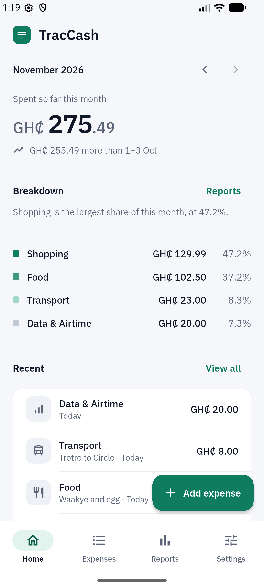
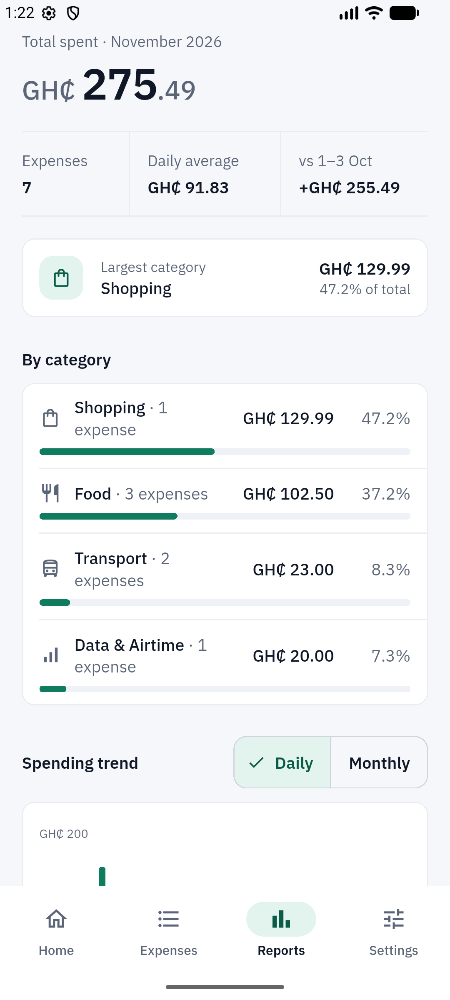
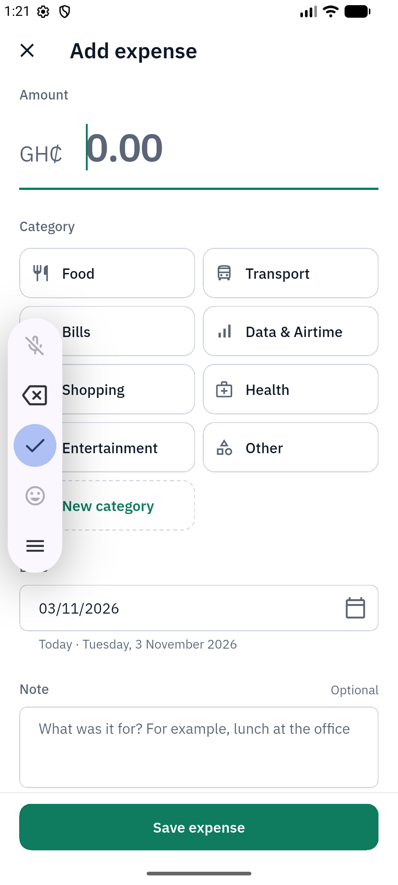
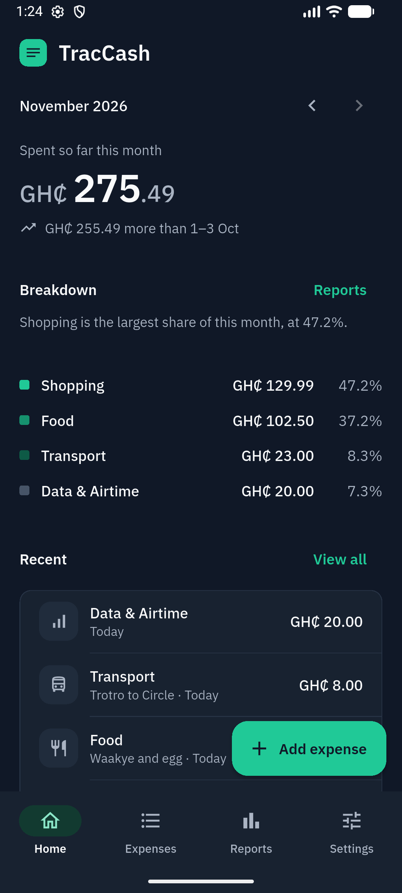
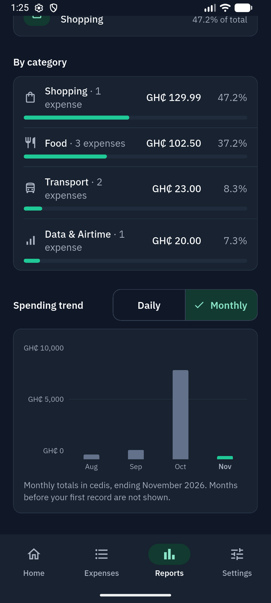
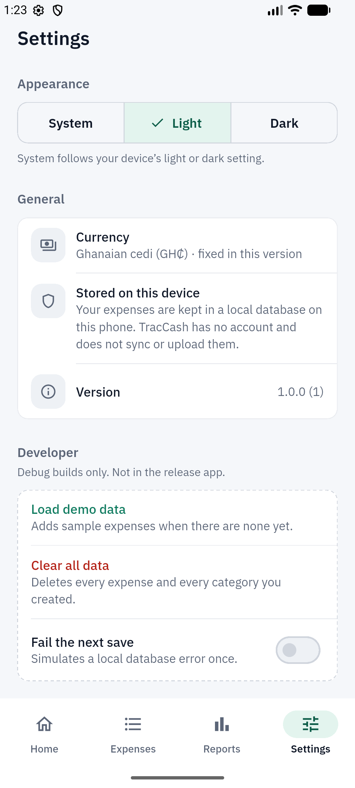
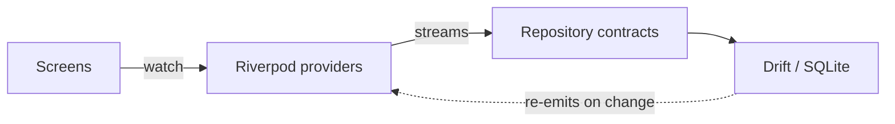

# TracCash

**An offline expense tracker for Android, in Ghana cedis.** No account, no server, no internet
permission. Your spending stays on your phone.

  
  
  

**[Download the APK](https://github.com/young-bossman/traccash/releases/latest)** · Android 7.0 or
newer · 32- and 64-bit ARM phones

## Features

- **Home:** the month's total, a comparison with the same days last month, the biggest
  categories and the latest expenses.
- **Expenses:** grouped by day, with search, a category filter, and edit or delete with Undo.
- **Reports:** daily average, a full category table, and daily or 6-month bar charts.
- **Your own categories,** alongside 8 presets such as Food, Transport and Data & Airtime.
- **Light, dark or system theme,** remembered between launches.
- **Works fully offline,** including in airplane mode.

  
  
  
  

## Tech stack

| Area | Choice |
| --- | --- |
| UI | Flutter, Material 3, IBM Plex Sans |
| State | Riverpod |
| Storage | Drift (SQLite), with CHECK constraints and foreign keys |
| Navigation | go_router, with a stateful bottom-tab shell |
| Charts | fl_chart |
| CI | GitHub Actions: format, analyze and tests on every push |

## How it's built

Screens never touch the database directly. Repositories are abstract contracts with a Drift
implementation, so every screen is tested against hand-written fakes. When data changes, Drift
re-emits its queries and every screen updates on its own, with no manual refresh.

## Engineering highlights

- **Money is never a floating-point number.** Every amount is stored as whole pesewas (`int`),
  and user input is parsed by string rules, so `0.29` is always exactly 29 pesewas.
- **Input is validated three times:** in the form, in the repository, and by database
  constraints.
- **Undo restores the same record,** with its original id and creation time.
- **Accessibility is tested,** not assumed: tap-target, label and contrast checks on 21 screen
  states in both themes, plus layout tests at large text sizes.
- **Data survives a restart,** proven by an integration test on a real Android device.
- **Release builds are hardened:** signed, obfuscated, with no internet permission, and checked
  to contain none of the debug tools.

## Tests

740 tests: unit tests for money, dates and every calculation; data tests on an in-memory SQLite;
widget tests for every screen and state; and an on-device integration test.

## Documentation

- [DEVELOPMENT.md](DEVELOPMENT.md): setup, running, testing and releasing
- [docs/ARCHITECTURE.md](docs/ARCHITECTURE.md): layers, data flow and data model
- [docs/DECISIONS.md](docs/DECISIONS.md): why things are the way they are
- [docs/design/DESIGN_SPEC.md](docs/design/DESIGN_SPEC.md): the design system

## Author

Bossman Amaglo · [GitHub](https://github.com/young-bossman)
